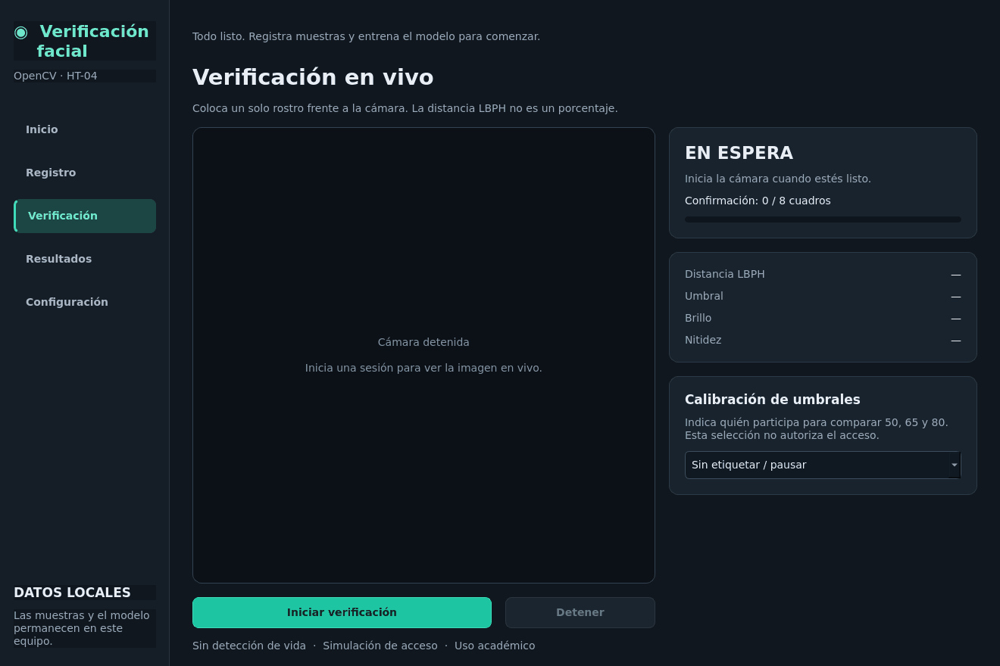

# Verificación facial con OpenCV

Aplicación de escritorio para la **HT-04 / Tarea 08 de Machine Learning y Deep Learning**. Permite registrar muestras, entrenar un modelo LBPH y simular la verificación de una persona desde una interfaz moderna en PySide6.



La captura muestra la aplicación implementada en estado de espera. No es una prueba de reconocimiento ni contiene un rostro o una decisión simulada.

## Inicio rápido en Windows

Utiliza **Python 3.12 de 64 bits**, una cámara web y una terminal en la carpeta del proyecto.

```powershell
python -m venv .venv
.\.venv\Scripts\Activate.ps1
python -m pip install --upgrade pip
python -m pip install -r requirements.txt
python app.py
```

Si PowerShell impide activar el entorno, puedes ejecutar directamente:

```powershell
.\.venv\Scripts\python.exe -m pip install -r requirements.txt
.\.venv\Scripts\python.exe app.py
```

Las dependencias están fijadas en `requirements.txt`: NumPy 2.3.5, OpenCV contrib 4.11.0.86 y PySide6 Essentials 6.12.0. No instales simultáneamente otras variantes de OpenCV porque comparten `cv2`.

Se utiliza OpenCV 4.11 porque incluye el XML Haar y el módulo LBPH necesarios. En la revisión local, el paquete 5.0.0.93 no contenía el XML Haar. La nueva selección se comprobó con Python 3.12.

## Cómo utilizar la aplicación

### 1. Registrar

En **Registro**, lee y marca la autorización. Presiona **Iniciar registro** y mantén un solo rostro ante la cámara. Varía ligeramente la posición con buena iluminación.

Se capturan 35 imágenes en escala de grises, de 160 × 160 píxeles, con al menos 150 ms entre muestras. Solo se capturan cuadros que superan los mínimos de brillo y nitidez.

El registro se prepara en memoria y se guarda al completar las 35 muestras. Si detienes antes de completarlo, las muestras previas se conservan. Al completar un registro nuevo, se sustituyen las anteriores y se invalida el modelo previo. Debes entrenar de nuevo. La autorización se desmarca al finalizar la sesión.

### 2. Entrenar

En **Inicio**, selecciona **Entrenar modelo**. Se requieren al menos 15 muestras válidas de 160 × 160; el registro de la interfaz genera 35. El entrenamiento utiliza LBPH y la etiqueta `1`.

La cámara y el entrenamiento se ejecutan en hilos de trabajo. La navegación se bloquea durante una operación para evitar sesiones simultáneas. Puedes detener la cámara; si cierras durante una operación, la ventana espera su finalización y libera los recursos.

### 3. Verificar

En **Verificación**, selecciona **Iniciar verificación**. La autorización simulada exige:

- Exactamente un rostro.
- Brillo medio de al menos 55 y varianza del Laplaciano de al menos 60.
- Etiqueta `1` y distancia LBPH estrictamente menor que el umbral.
- Ocho cuadros válidos consecutivos; cualquier cuadro inválido reinicia el contador.

Una distancia menor indica mayor similitud: **no es un porcentaje de confianza**. El rectángulo verde indica coincidencia en ese cuadro; la autorización requiere completar los ocho cuadros.

La selección de participante permite etiquetar la prueba como registrada o no registrada. Se comparan simultáneamente los umbrales 50, 65 y 80. Seleccionar una condición no autoriza el acceso. **Sin etiquetar / pausar** detiene el conteo estadístico, pero la verificación continúa.

### 4. Consultar y exportar resultados

En **Resultados** puedes consultar los últimos 200 eventos y la calibración de la última sesión, o exportar los CSV completos. Los eventos se acumulan; `calibracion.csv` se reemplaza al finalizar cada verificación que haya abierto la cámara.

La calibración cuenta **cuadros evaluados con calidad suficiente**, no intentos independientes. Los cuadros sin rostro o con mala calidad no se contabilizan. Sin etiquetar al participante, los contadores quedan en cero.

### 5. Configurar y eliminar datos

En **Configuración** elige el índice de cámara y el umbral 50, 65 u 80 antes de iniciar. Los cambios se aplican a la siguiente sesión y vuelven a los valores iniciales al cerrar la aplicación.

**Eliminar datos biométricos** exige escribir `ELIMINAR`. Solo borra `datos/usuario1_*.png` y `modelo/lbph.yml`. Los CSV y otros archivos se conservan. Después es necesario registrar y entrenar nuevamente.

## Ubicación de los datos

| Forma de ejecución | Ubicación |
| --- | --- |
| `python app.py` | Carpeta del proyecto, independientemente del directorio de la terminal. |
| Aplicación `.exe` | `%LOCALAPPDATA%\VerificacionFacial\` del usuario de Windows. |

En ambos casos, se generan `datos/`, `modelo/lbph.yml`, `eventos.csv` y `calibracion.csv`. La ruta activa aparece en Configuración, junto con un botón para abrirla. El `.exe` comienza sin datos y no importa automáticamente las muestras de la carpeta del código.

## Ejecutable de Windows

### Descargar la construcción de GitHub Actions

En la pestaña **Actions**, abre una ejecución correcta de **Verificar y construir Windows** y descarga el artefacto **VerificacionFacial-Windows**. Extrae el ZIP completo y abre `VerificacionFacial.exe`.

Conserva toda la carpeta, incluida `_internal`. No requiere instalar Python. Las construcciones no están firmadas digitalmente. El flujo guarda artefactos durante 30 días y también puede iniciarse manualmente desde Actions cuando esté disponible en la rama principal.

### Construir en tu computadora

Desde **Windows**, con el entorno activado:

```powershell
python -m pip install -r requirements-build.txt
python scripts/build_windows.py
```

La distribución queda en `dist/VerificacionFacial/`. Es una aplicación portable con un `.exe` y sus dependencias, no un instalador. Se incorpora el recurso Haar mediante `--collect-data cv2`. No se incorporan las muestras, los modelos ni los CSV locales.

El ejecutable de Windows debe construirse en Windows. La construcción automatizada ejecuta las pruebas, genera la distribución y comprueba el arranque del `.exe` sin cámara. El uso interactivo y la cámara deben comprobarse también en una PC Windows real.

## Estructura

| Archivo o carpeta | Función |
| --- | --- |
| `app.py` | Punto de entrada gráfico. |
| `facial/core.py` | Detección, calidad, decisión, calibración y almacenamiento. |
| `facial/workers.py` | Cámara y entrenamiento en hilos con señales Qt. |
| `facial/ui.py` | Cinco secciones, cámara integrada, controles, tablas y confirmaciones. |
| `registrar.py`, `entrenar.py`, `verificar.py`, `eliminar_datos.py` | Programas de la entrega anterior conservados. |
| `requirements.txt`, `requirements-build.txt` | Dependencias para ejecutar y empaquetar. |
| `scripts/build_windows.py` | Construcción portable con PyInstaller. |
| `scripts/smoke_windows.py` | Comprueba el arranque del ejecutable sin cámara. |
| `scripts/capture_ui.py` | Capturas de la interfaz vacía con carpeta temporal sin datos. |
| `tests/` | Pruebas de lógica, almacenamiento, hilos y controles Qt. |
| `docs/DESARROLLO.md` | Procedimiento antes/después y diagrama general. |
| `docs/PRUEBAS.md` | Verificación técnica y pruebas físicas pendientes. |
| `.github/workflows/windows.yml` | Pruebas y empaquetado para Windows. |

## Versión anterior y control de versiones

El punto de partida es el commit [`691be6f`](https://github.com/Dyronnt/verificacion-facial-opencv/commit/691be6fd422a86dad97982ee7843580a9c554218), que ya incluye seis mejoras: calibración, confirmación temporal, calidad, eventos, panel informativo y eliminación de datos.

Las nuevas mejoras se desarrollan en `mejora/interfaz-escritorio` con commits por etapa. La versión anterior se puede descargar desde ese commit para construir el apartado `ANTES` de la entrega. No es necesario duplicar todo el proyecto dentro del repositorio.

Los programas originales siguen disponibles:

```powershell
python registrar.py
python entrenar.py
python verificar.py
python eliminar_datos.py
```

Ejecuta esos programas desde la raíz del proyecto y evita abrirlos mientras la aplicación está usando la cámara. En la verificación original: R/N etiquetan al participante, P pausa la calibración, 1/2/3 seleccionan el umbral y Q finaliza.

## Verificación técnica

```powershell
python -m unittest discover -s tests -v
python -c "import cv2; from pathlib import Path; print(cv2.__version__); print(hasattr(cv2, 'face')); print(Path(cv2.data.haarcascades, 'haarcascade_frontalface_default.xml').is_file())"
```

Las pruebas usan matrices sintéticas y cámaras/detectores controlados; también entrenan y recargan un LBPH real con imágenes sintéticas. No demuestran precisión biométrica, detección con personas reales ni rendimiento de la cámara física.

Para regenerar las capturas de la interfaz sin datos:

```powershell
python scripts/capture_ui.py
```

## Problemas frecuentes

| Problema | Acción |
| --- | --- |
| Falta `cv2.face` o el XML Haar | Instala `requirements.txt` en un entorno limpio y ejecuta la comprobación anterior. |
| Cámara no disponible | Revisa permisos, cierra otras aplicaciones y cambia el índice en Configuración. |
| Modelo pendiente | Completa Registro y luego Entrenar modelo en Inicio. |
| Registro no avanza | Mejora iluminación, enfoque y posición; debe aparecer un solo rostro. |
| Se rechaza al participante registrado | Revisa muestras, iluminación y distancias; compara los umbrales con pruebas etiquetadas. |
| Calibración en cero | Selecciona la condición del participante y comprueba la calidad del rostro. |
| Falla el `.exe` al moverlo | Conserva `_internal` y todos los archivos de la distribución. |

## Alcance y privacidad

El sistema **simula acceso a una aplicación**: no desbloquea Windows ni controla dispositivos físicos. No incorpora detección de vida; una fotografía puede engañarlo. La iluminación, el enfoque y la orientación afectan las decisiones. La interfaz y el empaquetado facilitan el uso, pero no demuestran una mejora de precisión o de resistencia a suplantaciones.

Utiliza tu propio rostro o el de una persona que autorice su participación. Las muestras y el modelo se mantienen localmente y se excluyen de Git mediante `.gitignore`. No publiques capturas que expongan identidades sin autorización. Los datos locales no están cifrados por esta aplicación.

## Referencias

- [OpenCV: LBPH](https://docs.opencv.org/4.x/df/d25/classcv_1_1face_1_1LBPHFaceRecognizer.html)
- [Qt for Python: hilos y señales](https://doc.qt.io/qtforpython-6/PySide6/QtCore/QThread.html)
- [PyInstaller: uso y empaquetado](https://pyinstaller.org/en/stable/usage.html)
