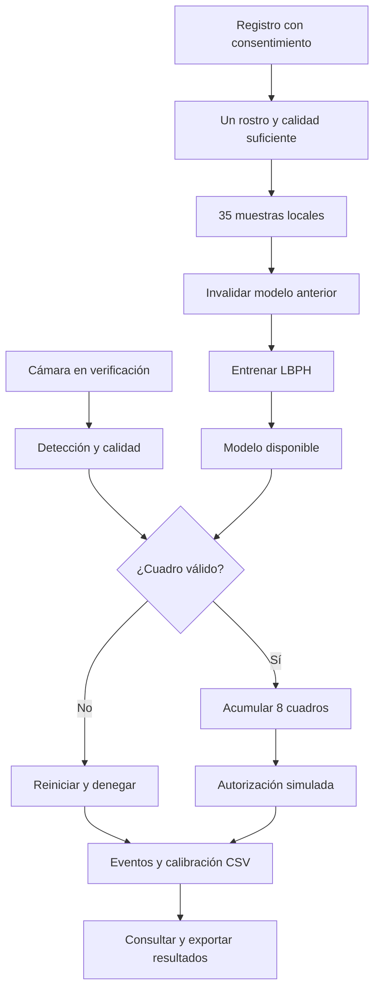
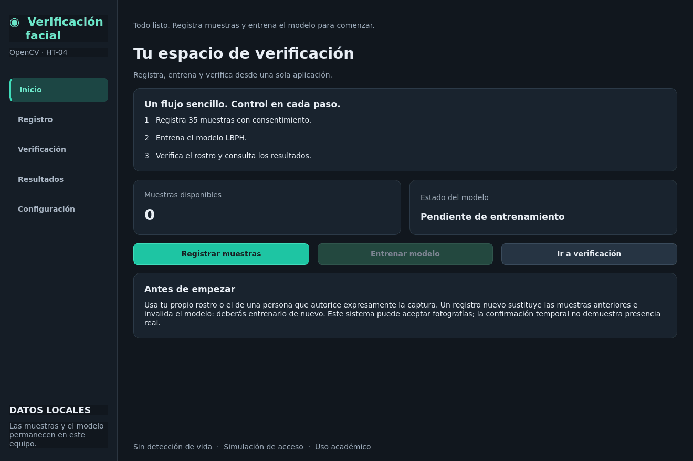
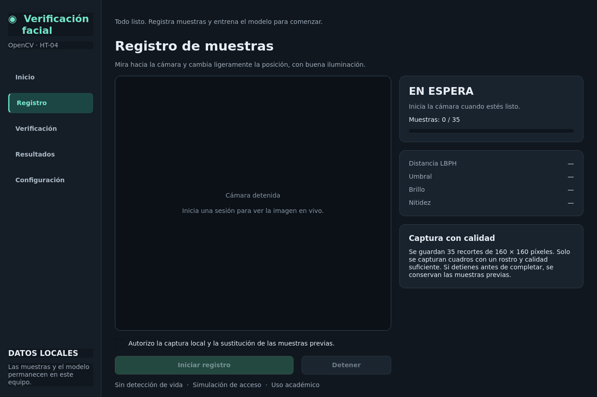
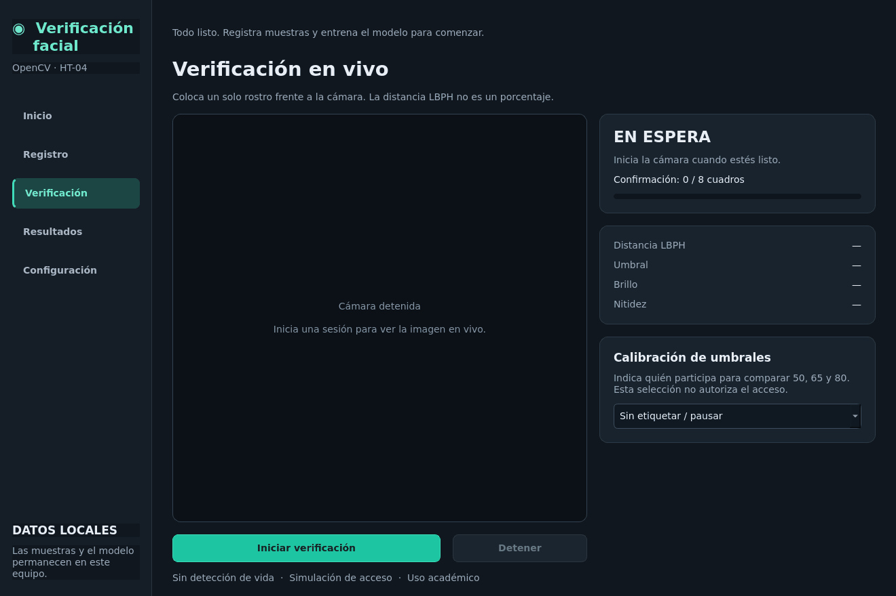
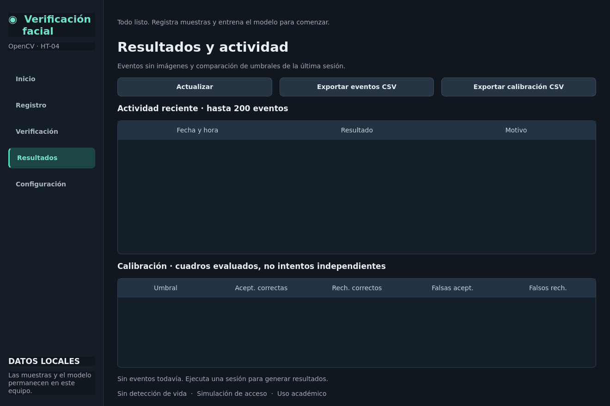
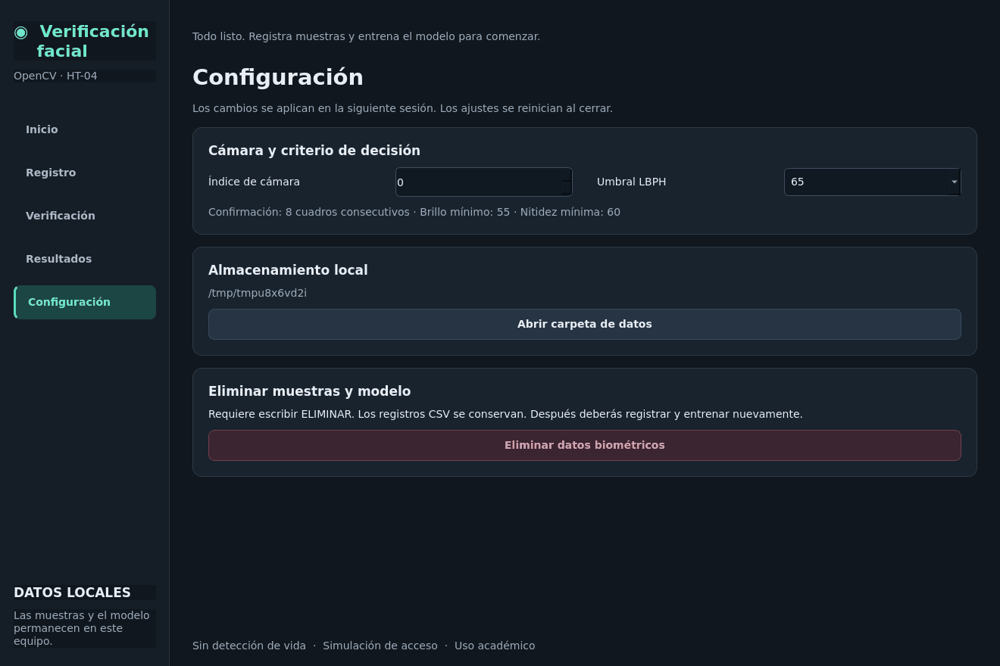

# HT-04 · Procedimiento de desarrollo

Tarea más significativa: **HT-04 Describe los principios de visión computacional y Machine Learning**. Curso: Machine Learning y Deep Learning. Práctica: verificación facial con OpenCV para simular el acceso a una aplicación.

Este documento registra lo implementado y sirve como base para redactar el informe en primera persona. Las pruebas con cámara física y los resultados personales deben incorporarse después de realizarlos. No se atribuyen al estudiante pruebas aún pendientes.

## Descripción del proceso antes de la mejora

El proyecto inicial se organizaba en cuatro programas de Python: `registrar.py`, `entrenar.py`, `verificar.py` y `eliminar_datos.py`. Para usarlos, era necesario abrir una terminal en la carpeta del proyecto y ejecutar cada programa por separado.

Primero, `registrar.py` creaba la carpeta `datos/`, cargaba el detector Haar y abría la cámara. Cuando detectaba exactamente un rostro, convertía la imagen a escala de grises, recortaba el rostro y lo redimensionaba a 160 × 160 píxeles. Guardaba hasta 35 imágenes con nombres como `usuario1_000.png`.

Después, `entrenar.py` leía las muestras. Con al menos 15 imágenes legibles, entrenaba `cv2.face.LBPHFaceRecognizer_create()` utilizando la etiqueta 1 y guardaba el modelo en `modelo/lbph.yml`.

La verificación ya incorporaba las seis mejoras de la Tarea 08. Comprobaba el brillo medio y la varianza del Laplaciano; si la calidad era suficiente, calculaba la etiqueta y la distancia LBPH. Exigía ocho cuadros consecutivos con etiqueta 1 y distancia menor que el umbral. Un cuadro inválido reiniciaba la confirmación.

También comparaba los umbrales 50, 65 y 80. Las teclas R y N indicaban la condición real del participante, y P pausaba la recopilación de estadísticas. Las teclas 1, 2 y 3 elegían el umbral activo. Al cerrar, se guardaba `calibracion.csv`.

Los cambios de estado se añadían a `eventos.csv` con fecha, resultado y motivo, sin imágenes. La ventana de OpenCV mostraba un panel negro con las mediciones, las instrucciones y el progreso. Finalmente, `eliminar_datos.py` permitía borrar muestras y modelo tras escribir ELIMINAR.

Esta base funcionaba mediante programas separados y atajos de teclado. Ya tenía controles de reconocimiento; la nueva mejora se centra en integrar el flujo, facilitar el uso y preparar una distribución de escritorio.

## Descripción del proceso después de la mejora

### 1. Conservar el punto de partida

Se identificó el commit `691be6fd422a86dad97982ee7843580a9c554218` y se creó la rama `mejora/interfaz-escritorio`. Los cuatro programas originales se conservaron para consultar y comparar la implementación anterior.

### 2. Preparar dependencias y recursos

Se incorporó PySide6 Essentials para crear la interfaz y se fijaron las dependencias de ejecución. Se comprobó la disponibilidad de `cv2.face` y del XML Haar. En el entorno de revisión, OpenCV 5.0.0.93 no incluía ese archivo; se utilizó OpenCV contrib 4.11.0.86, que sí lo proporciona. El entorno verificado usa Python 3.12 y NumPy 2.3.5.

### 3. Separar procesamiento y presentación

En `facial/core.py` se organizaron las configuraciones, los resultados de cada cuadro y el almacenamiento. `Engine.analyze()` detecta rostros, prepara el recorte, calcula brillo y nitidez y, si existe modelo, realiza la predicción. La interfaz recibe una decisión estructurada con el estado, el motivo, la distancia y el contador.

Se conservaron los parámetros principales: umbral inicial 65, ocho cuadros de confirmación, brillo mínimo 55 y nitidez mínima 60. La comparación estadística sigue usando 50, 65 y 80; la condición declarada por el participante solo clasifica los resultados de calibración.

### 4. Implementar la ventana moderna

En `facial/ui.py` se construyó una ventana con fondo oscuro, tarjetas, acentos turquesa y cinco secciones: Inicio, Registro, Verificación, Resultados y Configuración. La imagen de cámara se convierte de BGR a RGB y se presenta dentro de la ventana mediante una copia de `QImage`.

Inicio muestra el número de muestras, el estado del modelo y las acciones principales. Registro incorpora autorización explícita y progreso. Verificación presenta el estado, el motivo, los ocho cuadros y las mediciones. Resultados ofrece tablas y exportación de CSV. Configuración permite seleccionar cámara y umbral y gestionar los archivos locales.

### 5. Ejecutar cámara y entrenamiento sin bloquear la ventana

En `facial/workers.py` se crearon hilos `QThread`. La cámara emite imágenes y decisiones mediante señales; el entrenamiento comunica finalización o error. Los widgets se actualizan desde la interfaz.

Durante una operación se deshabilita la navegación para evitar acciones incompatibles. Detener solicita la interrupción de la cámara. El bloque `finally` libera el dispositivo, y el cierre de la ventana espera a que termine el trabajo activo sin destruir prematuramente el hilo.

### 6. Mejorar el registro y evitar modelos obsoletos

La interfaz exige consentimiento antes de abrir el registro. Las muestras se acumulan en memoria, separadas por al menos 150 ms y sujetas al control de calidad. Al completar 35, se preparan los archivos y se sustituyen las muestras anteriores. Detener una captura incompleta conserva el registro previo.

Un registro completo elimina el modelo anterior para impedir que se verifique con un entrenamiento que ya no corresponde a las muestras actuales. Después se solicita entrenar de nuevo. El modelo se escribe primero en un archivo temporal y luego se publica en `lbph.yml`.

### 7. Consultar resultados y administrar datos

Los eventos mantienen fecha/hora, resultado y motivo. La calibración se guarda al terminar una sesión de verificación con cámara abierta. La pantalla Resultados muestra hasta 200 eventos recientes, pero la exportación copia el CSV completo.

La eliminación gráfica exige escribir ELIMINAR y conserva los CSV. Las rutas de la aplicación se calculan de forma independiente del directorio de ejecución. En el `.exe`, los datos se guardan en la carpeta local del usuario de Windows, separada de los recursos del programa.

### 8. Preparar la distribución

Se añadió `scripts/build_windows.py`, que ejecuta PyInstaller en Windows con `--windowed`, `--onedir` y `--collect-data cv2`. La salida es una carpeta portable con `VerificacionFacial.exe` y sus dependencias. No se empaquetan datos biométricos locales.

El workflow de GitHub Actions instala dependencias, ejecuta las pruebas y construye la distribución en Windows. Que el empaquetado termine correctamente no demuestra el funcionamiento de la cámara en la computadora del participante; esa comprobación se registra por separado.

### 9. Verificar y documentar

Se añadieron pruebas de confirmación temporal, calidad, calibración, almacenamiento, registro completo y cancelado, entrenamiento LBPH con matrices sintéticas, consentimiento, errores y cierre. Se generaron capturas reales de las cinco pantallas vacías mediante `scripts/capture_ui.py`, sin atribuirles resultados biométricos.

El README contiene instalación, ejecución, empaquetado, ubicación de datos y solución de problemas. La tabla de `PRUEBAS.md` distingue la verificación automatizada de las pruebas físicas pendientes.

## Diagrama general

El procesamiento y las decisiones se muestran en una sola aplicación; la versión portable utiliza la misma lógica.

## Capturas de interfaz implementada

Estas imágenes se generaron con la aplicación real, sin cámara activa y utilizando una carpeta temporal vacía. Sirven para mostrar la organización visual. Las evidencias de registro, entrenamiento y reconocimiento físico deben capturarse durante las pruebas del participante.

Inicio: flujo de registro, entrenamiento y verificación con estado de los datos.

Registro: consentimiento explícito y controles de captura.

Verificación: cámara integrada, estado y mediciones en espera.

Resultados: tablas de eventos y comparación de umbrales antes de generar registros.

Configuración: selección de cámara, umbral y administración de datos.
